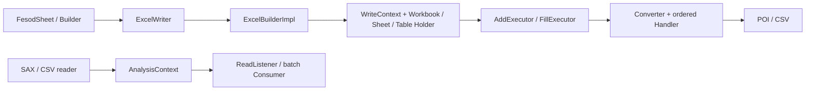
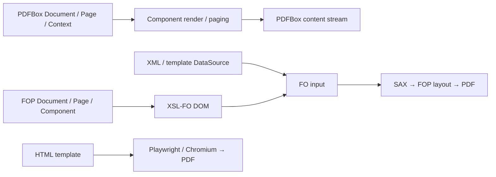

# Fesod、x-easypdf 架构研究与 Export4j 优化评估

研究日期：2026-11-19。结论来自实际源码和一个 Export4j 制品调用探针，不根据项目介绍推定内部实现，也没有复制参考项目的代码、注释或测试。

Export4j 应保留现有的统一语义／布局／绘制分层，优先减少跨目标规则漂移和调用方重复装配。研究首先复现了 DOCX 相对列宽缺陷：合法比例在不同路径中产生不同结果。其余条目分别属于入口改进、维护性改进和性能机会。后续已逐项落实以下六项处理，实际构建、消费、输出和测量证据统一见[接入验收](verification/architecture-convergence.md)。

## 源码基线与比较范围

| 项目 | 固定源码 | 本次研究的范围 |
| --- | --- | --- |
| Apache Fesod（Incubating） | [fc1e43d7a9b82978168dcae5b2ed09e1fbed8c29](https://github.com/apache/fesod/tree/fc1e43d7a9b82978168dcae5b2ed09e1fbed8c29)，当次 `main`；POM 为 `dev-SNAPSHOT` | 入口、写入与填充执行器、分层配置、转换器与事件、流式读取、缓存及收尾 |
| x-easypdf | [549a76f9ce382f25456a67ab27dfce2c79bfc8f8](https://github.com/xsx344646090/x-easypdf/tree/549a76f9ce382f25456a67ab27dfce2c79bfc8f8)，当次 `master`；POM 为 `3.5.5` | PDFBox／FOP 两条路线、文档与组件上下文、字体、模板、资源和扩展 |
| Export4j | `develop` 的 `721a4f13c88a2873ee83f43e1161678aff8c5f1b` 加当时未提交的修复 | starter、组件编排、模型、布局、DOCX、模板及字体资源链路 |

两个参考仓库的提交均核对过远端。Fesod 是电子表格读写项目，其行处理经验可以参考，但 Excel 写入吞吐不能证明 PDF 分页性能。x-easypdf 的两种实现也不能合称同一布局引擎的两个输出后端。本轮未构建参考项目、未执行它们的单元测试或性能基准。

## Fesod：按操作组织上下文、执行器和扩展点

根 [POM](https://github.com/apache/fesod/blob/fc1e43d7a9b82978168dcae5b2ed09e1fbed8c29/pom.xml#L66) 包含 `fesod-common`、`fesod-shaded`、`fesod-sheet`、BOM 和 benchmark；读写实现集中在 sheet，依赖 POI、CSV 和 Ehcache。shaded 模块重定位 Spring ASM／CGLIB；它不是独立于这些基础设施的文档排版内核。

实际写入链见 [FesodSheet](https://github.com/apache/fesod/blob/fc1e43d7a9b82978168dcae5b2ed09e1fbed8c29/fesod-sheet/src/main/java/org/apache/fesod/sheet/FesodSheet.java#L49)、[ExcelBuilderImpl](https://github.com/apache/fesod/blob/fc1e43d7a9b82978168dcae5b2ed09e1fbed8c29/fesod-sheet/src/main/java/org/apache/fesod/sheet/write/ExcelBuilderImpl.java#L57) 和 [WriteContextImpl](https://github.com/apache/fesod/blob/fc1e43d7a9b82978168dcae5b2ed09e1fbed8c29/fesod-sheet/src/main/java/org/apache/fesod/sheet/context/WriteContextImpl.java#L118)。Facade 不负责单元格的所有实现细节，Add 与 Fill 分开执行，并在同次操作中复用上下文。

| 机制 | 源码依据与观察 | 对 Export4j 的启发与限制 |
| --- | --- | --- |
| 分层配置 | [AbstractWriteHolder](https://github.com/apache/fesod/blob/fc1e43d7a9b82978168dcae5b2ed09e1fbed8c29/fesod-sheet/src/main/java/org/apache/fesod/sheet/write/metadata/holder/AbstractWriteHolder.java#L176) 按 Workbook→Sheet→Table 解析未声明属性，局部转换器覆盖继承映射 | 入口声明与运行期解析结果分开。Export4j 已有 `ContentOptions.overlay/resolve`，应防止不同入口再各自解释继承，不需要重建主题体系 |
| 明确的扩展阶段 | 同文件第 297／434 行构建按 `order` 排序、按声明去重的 handler 链；[Converter](https://github.com/apache/fesod/blob/fc1e43d7a9b82978168dcae5b2ed09e1fbed8c29/fesod-sheet/src/main/java/org/apache/fesod/sheet/converters/Converter.java#L41) 区分 Java／单元格转换 | 扩展应绑定明确阶段。其 handler context 暴露 POI Cell／Row，不能直接套进 Export4j 的后端中立 SPI，也不应允许后端回调再次分页 |
| 文档级格式复用 | [WriteWorkbookHolder](https://github.com/apache/fesod/blob/fc1e43d7a9b82978168dcae5b2ed09e1fbed8c29/fesod-sheet/src/main/java/org/apache/fesod/sheet/write/metadata/holder/WriteWorkbookHolder.java#L326) 复用样式、字体及数据格式 | 学习按对象所属文档复用；不能把 POI 样式对象或 PDFont 跨文档缓存。Export4j 已有模型压缩、文档字体映射及子集缓存 |
| 流式与批处理分开 | [ExcelAnalyserImpl](https://github.com/apache/fesod/blob/fc1e43d7a9b82978168dcae5b2ed09e1fbed8c29/fesod-sheet/src/main/java/org/apache/fesod/sheet/analysis/ExcelAnalyserImpl.java#L111) 选择 XLS／XLSX SAX 或 CSV 执行器；[PageReadListener](https://github.com/apache/fesod/blob/fc1e43d7a9b82978168dcae5b2ed09e1fbed8c29/fesod-sheet/src/main/java/org/apache/fesod/sheet/read/listener/PageReadListener.java#L68) 到批量后交给 Consumer | 便捷入口不应要求先收集全部数据。批处理 listener 只约束其缓冲，不能代替整条输出链路的资源证明 |
| 内存与磁盘策略可选 | [WorkBookUtil](https://github.com/apache/fesod/blob/fc1e43d7a9b82978168dcae5b2ed09e1fbed8c29/fesod-sheet/src/main/java/org/apache/fesod/sheet/util/WorkBookUtil.java#L55) 选择 XSSF／SXSSF；[SimpleReadCacheSelector](https://github.com/apache/fesod/blob/fc1e43d7a9b82978168dcae5b2ed09e1fbed8c29/fesod-sheet/src/main/java/org/apache/fesod/sheet/cache/selector/SimpleReadCacheSelector.java#L100) 根据共享字符串大小选择 Map／Ehcache | 学习显式资源策略及磁盘退出清理，不复制阈值。Export4j 已有逐页、重放、spool，无需再建流式内核 |
| 操作结束集中清理 | [WriteContextImpl.finish](https://github.com/apache/fesod/blob/fc1e43d7a9b82978168dcae5b2ed09e1fbed8c29/fesod-sheet/src/main/java/org/apache/fesod/sheet/context/WriteContextImpl.java#L491) 关闭 workbook、dispose SXSSF 临时资源并清理线程缓存；读取器另有 finish/destroy | 资源所有权、失败清理和主／suppressed 异常要有固定边界；不能推定用户传入流也应被默认关闭 |

不建议照搬其可变全局／线程缓存配置。源码 [ClassUtils](https://github.com/apache/fesod/blob/fc1e43d7a9b82978168dcae5b2ed09e1fbed8c29/fesod-sheet/src/main/java/org/apache/fesod/sheet/util/ClassUtils.java#L69) 同时存在 MEMORY、THREAD_LOCAL、NONE 分支；[默认配置](https://github.com/apache/fesod/blob/fc1e43d7a9b82978168dcae5b2ed09e1fbed8c29/fesod-sheet/src/main/java/org/apache/fesod/sheet/metadata/GlobalConfiguration.java#L86) 为 THREAD_LOCAL。生命周期和类加载器引用必须分别分析，不能概括为“全局缓存自然更快”。Export4j 的 DTO 属性计划目前限定在单次绑定，已有[取舍记录](../.agents/notes/implemented/feature/2026-11-14-template-object-snapshot.md)。

## x-easypdf：两套布局与各自的适配边界

根 [POM](https://github.com/xsx344646090/x-easypdf/blob/549a76f9ce382f25456a67ab27dfce2c79bfc8f8/pom.xml#L43) 包含 pdfbox、fop 和 all。pdfbox 模块使用独立的 `x-easypdf-shade-pdfbox` 依赖，不能把该制品版本误当作官方 PDFBox 版本；本轮未审查这个独立 shade 制品的内部实现。

| 机制 | 源码依据与观察 | 对 Export4j 的启发与限制 |
| --- | --- | --- |
| PDFBox 文档上下文 | [Context](https://github.com/xsx344646090/x-easypdf/blob/549a76f9ce382f25456a67ab27dfce2c79bfc8f8/x-easypdf-pdfbox/src/main/java/org/dromara/pdf/pdfbox/core/base/Context.java#L253) 在文档内复用 PDFont；[AbstractComponent.render](https://github.com/xsx344646090/x-easypdf/blob/549a76f9ce382f25456a67ab27dfce2c79bfc8f8/x-easypdf-pdfbox/src/main/java/org/dromara/pdf/pdfbox/core/component/AbstractComponent.java#L625) 执行初始化、绘制及复位，组件控制分页 | 学习清楚的操作上下文及一次装配；Export4j 继续把测量／分页与绘制分开，不能引入共享可变页面游标 |
| 参数继承 | [FontConfiguration](https://github.com/xsx344646090/x-easypdf/blob/549a76f9ce382f25456a67ab27dfce2c79bfc8f8/x-easypdf-pdfbox/src/main/java/org/dromara/pdf/pdfbox/core/base/config/FontConfiguration.java#L153) 以 null 区分未声明；Page／Textarea 创建时复制配置 | 学习声明意图，不能将创建时复制描述为父配置修改后的实时继承；Export4j 保持不可变快照 |
| 字体分层 | [FontHandler](https://github.com/xsx344646090/x-easypdf/blob/549a76f9ce382f25456a67ab27dfce2c79bfc8f8/x-easypdf-pdfbox/src/main/java/org/dromara/pdf/pdfbox/handler/FontHandler.java#L132) 从 provider 获取字体，再创建当前文档 PDFont；名称失败时可采用默认字体 | 区分字体注册、解析程序、文档 PDFont 和磁盘字体索引；不采用隐式回退。该仓库表层代码不足以证明 shade provider 的完整 TTL 行为 |
| FOP 路线 | [DocumentDataSource](https://github.com/xsx344646090/x-easypdf/blob/549a76f9ce382f25456a67ab27dfce2c79bfc8f8/x-easypdf-fop/src/main/java/org/dromara/pdf/fop/core/datasource/DocumentDataSource.java#L63) 将 FO DOM 转流；[DataSource](https://github.com/xsx344646090/x-easypdf/blob/549a76f9ce382f25456a67ab27dfce2c79bfc8f8/x-easypdf-fop/src/main/java/org/dromara/pdf/fop/core/datasource/DataSource.java#L78) 经 SAX 交给 FOP | 学习输入适配与执行分开；FOP 决定该路线的布局，不复用 PDFBox 路线的分页算法 |
| 工厂与模板复用 | [TemplateParam](https://github.com/xsx344646090/x-easypdf/blob/549a76f9ce382f25456a67ab27dfce2c79bfc8f8/x-easypdf-fop/src/main/java/org/dromara/pdf/fop/core/base/TemplateParam.java#L187) 延迟初始化工厂／user agent；[FreemarkerTemplater](https://github.com/xsx344646090/x-easypdf/blob/549a76f9ce382f25456a67ab27dfce2c79bfc8f8/x-easypdf-pdfbox/src/main/java/org/dromara/pdf/pdfbox/core/ext/templater/FreemarkerTemplater.java#L45) 复用 Configuration | 可复用静态编译环境，不能照搬无界 static 路径缓存，也不能把绑定了当次 parser／字体的模板长期保存 |
| 真实转换路径 | [HtmlConvertor](https://github.com/xsx344646090/x-easypdf/blob/549a76f9ce382f25456a67ab27dfce2c79bfc8f8/x-easypdf-pdfbox/src/main/java/org/dromara/pdf/pdfbox/core/ext/convertor/html/HtmlConvertor.java#L503) 包含 Playwright／Chromium；[Template.transform](https://github.com/xsx344646090/x-easypdf/blob/549a76f9ce382f25456a67ab27dfce2c79bfc8f8/x-easypdf-fop/src/main/java/org/dromara/pdf/fop/core/base/Template.java#L345) 无参入口先完整缓冲 PDF，再重新载入 | “模板”“转 PDF”不代表纯 Java 内核、单遍或恒内存。Export4j 保持生产导出不依赖浏览器／Office 的现有契约 |

FOP 的字体 resolver 还允许 URI／URL 资源，组件扩展也可以直接依赖 FOP LayoutManager。它们适合自身定位，但不能成为 Export4j 默认外联资源或泄漏第三方句柄的理由。参考项目许可分别为 Apache-2.0 与 Mulan PSL v2；本轮仅记录设计观察，不引入其源码或新运行依赖。

## Export4j 已具备的结构

现有[架构](architecture.md)是 `Document Model → Layout Engine → Layout IR → Display List → Backend`；DOCX 直接映射语义模型。starter 位于外围，核心不反向依赖它。这些边界应保留。

| 已具备 | 当前入口 | 本轮判断 |
| --- | --- | --- |
| 全局与逐块配置 | `DocumentTheme`、`ContentOptions`、XML scope、字体角色作用域 | 已存在，重点是跨入口解释一致，不再建设另一套继承系统 |
| 字体缓存与空闲回收 | [字体缓存 API](font-cache-api.md)、`FontFaceCache`、`PdfFontCache` | 已有容量、TTL、拥有／借用与解析独占租约；不应重建永久字体注册表 |
| 对象数据绑定 | `DocumentTemplate`、DTO／record／Map | 已有有界快照，不将任意业务对象自动字符串化或增加隐式反射范围 |
| 流式与大文档 | [流式／重放 API](streaming-replay-api.md)、逐页与 spool | 底层已实现，便捷层可达性与底层能力缺失是两回事 |
| 扩展与验证 | `Component`／`PageableComponent`、后端 SPI、预算、原子输出、独立消费者 | 不需要先增加一个覆盖全部阶段的通用插件系统 |

## 六项优化的接入结果

### 1. 统一有限正相对权重，修复 DOCX 溢出

修前制品探针确认：两列 `Fraction(1e308)` 因原始求和溢出而失败；单列同权重错误成功，将 `tblGrid`、`tcW` 和 `tblW` 写为 `9223372036854775807`。它们应与权重 `1` 产生同样的宽度。

[RelativeWeights](../export4j-model/src/main/java/com/mirakyux/export4j/model/RelativeWeights.java) 现统一负责有限正相对数的快照、最大值归一化、补偿求和及份额分配，供布局、公式内容投影和 DOCX 使用。极端小比例只在需要时使用有界精度十进制除法，避免先除后乘把可表示的正宽提前变成零。各模块继续负责自己的固定列、Auto 测量、padding、预算和目标单位。DOCX 另检查正有限宽度、twips 范围及累计溢出，避免 `Math.round` 饱和伪装成成功。

补充复核修正了极小总量的双重舍入：权重 `0.75, 1` 分配 `Double.MIN_VALUE` 时，第一份应舍入为零并按契约拒绝，不能把两份都接受为一个最小 double。subnormal 结果现按精确 `Double.MIN_VALUE` 单位执行 HALF_EVEN 舍入，普通数值路径保留原运算顺序。单独舍入不承诺所有份额相加严格守恒，例如两份 `1.5` 个最小单位各自会舍入为 `2`。

分栏保持原有 `available * share` 运算顺序；它与表格的乘后除在字形边界可能差一个 ULP。两栏和 `[10,1,1]` 三栏新增精确列宽、实际换行和完整原文回归，不用放宽断言掩盖分页变化。

### 2. 按次形成不可变字体绑定，开放角色和 PDF 后端配置

[OperationFonts](../export4j-starter/src/main/java/com/mirakyux/export4j/OperationFonts.java) 在一次输出内集中来源、真实变体、内容解析角色、PDF 字体组与 DOCX 字体声明；同一个来源对象只载入一次。新增 `fontRole(name, family)` 提供稳定业务名及真实变体映射，角色专用字体不自动加入默认缺字回退栈。局部配置继续保留空角色、黑色、false 等显式覆盖意图。Markdown／HTML 的强调继承当前族，缺少真实变体仍严格失败。

`Export4j.Builder.pdfBackend(backend)` 借用调用方配置的不可变后端，可使用已有 `PdfFontCache` 与临时文件流缓冲。关闭 exporter 不关闭借用缓存；每次输出仍有独立 PDF 文档及会话。PDF 严格缺字与 DOCX 只声明字体名的差异保持。详见[统一入口](easy-export-api.md)与[字体缓存](font-cache-api.md)。

### 3. 共享语义准备，保留完整与逐页的不同保留策略

[PreparedSemanticDocument](../export4j-components/src/main/java/com/mirakyux/export4j/components/PreparedSemanticDocument.java) 为包内不可变结果，共享导航冲突、语义编译、源块、保留标识和脚注源预算验证。完整模式继续保留布局 IR；逐页模式继续紧凑证明和重放，不收集全部页面，也不增加全局 Session。字段、来源身份、错误位置和预算继续由既有契约约束。

### 4. 显式复用 XML 静态语法计划

`XmlTemplate.prepare(String/Reader)` 返回用户持有的不可变 `Syntax`；`compile(Syntax)` 每次使用当前主题、资源键、parser、执行预算和绑定快照。starter 提供 `prepareXml` 与接收 `Syntax` 的 XML 请求。prepare 仅解析安全结构并静态展开已配置片段，不打开内容 parser、不加载物理字体、不绑定数据；它不等于完整语义校验。配置改变时仍重新检查语义和全部输入／展开预算，没有缓存捕获运行资源的完整模板。

200 段、6,213 字符模板的三次独立 JVM 探针，每次预热后执行 100 次 compile＋render；复用计划减少约 17% 主线程分配。计时只描述该局部路径，未证明整个 PDF／DOCX 导出的吞吐提升。详见[XML 模板](xml-template-api.md)和[测量边界](verification/architecture-convergence.md#受控局部测量)。

### 5. 避免不可变 bytes 来源命中前的复制和摘要，冷解析移出锁

`FontSource.bytes` 持有一份外部隔离快照及内容标识，同一来源再次加载可直接查询缓存；公开 `FontFaceCache.load(byte[])` 仍先保护外部数组。文件／资源来源仍重读当前内容，不按路径或 mtime 猜测。冷解析和摘要在缓存锁外运行，同键正在解析的请求在有限条数／字节的 pending 中合并；超出协调预算的请求本地解析而不驻留，不把缓存容量当字体输入拒绝条件。

`clear`／`close` 撤销正在解析结果的驻留资格；已开始的解析可返回调用方持有的不可变 face，关闭后拒绝新载入。同键等待、失败、打断、清理调度失败与 clear 后新一代载入分别有回归。来源自身的编码快照随来源存活，缓存 TTL 只移除缓存引用；外部持有 face 仍延长其寿命。没有恢复已否决的 FontBox 源码补丁、永久字体注册表或跨文档 PDFont 缓存。

固定 13,110,528 字节字体、预热后 100 次同来源命中的三次独立 JVM 探针，主线程累计分配由约 1.25 GiB 降至约 3.1 KiB。该数字排除来源创建和首次解析，不代表单次导出用这么多堆，也不证明 RSS 或长期存活内存下降。并发探针仅证明稳定命中不再等候其他字体的冷解析大锁。详见[受控测量](verification/architecture-convergence.md#受控局部测量)。

### 6. 封装临时测量状态的恢复

`DocumentLayouter.Flow.MeasurementScope` 保存并恢复变宽测量标志、试探／免计费模式、来源路径，以及需要恢复的行计数。分栏重测、变量宽表及递归块格用局部作用域包住实际测量，异常与取消也走同一恢复边界。它没有改变布局协调者、增设第二套分页算法或放宽源／呈现预算。回归检查取消后再布局的结果、嵌套来源及试探计费。

## 证据、记录与边界

原研究、固定源码和修前探针在忽略目录 `build/research/architecture-20261119/`；最初构建、受控测量与输出记录在 `build/verification/architecture-fixes-20261119/`，极小总量补查及最终复验在 `build/verification/architecture-final-20261120/`。长期取舍见[已实现笔记](../.agents/notes/implemented/architecture/2026-11-19-reference-architecture-convergence.md)，可复现命令和实际验证状态见[接入验收](verification/architecture-convergence.md)。

本轮没有构建或压测两个参考项目，不提供三项目吞吐排名。局部优化不代表任意模板、全部字体格式、恶意输入沙箱或恒定内存；DOCX 结构、独立阅读器渲染与 Word 实际编辑保存分别登记。构建、本地临时签名和隔离制品消费不代表 Maven Central 发布或部署。
